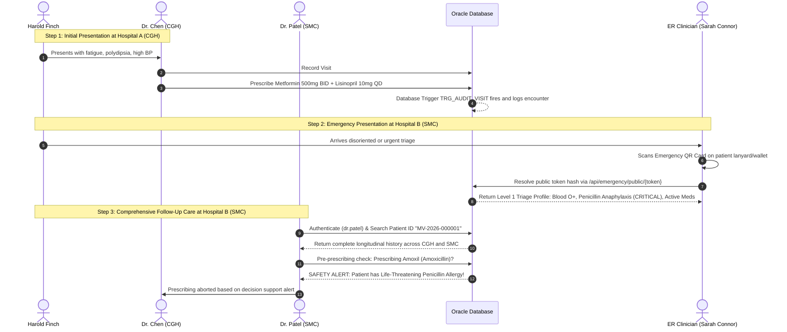

# MediVault System Architecture

MediVault is designed as a secure, three-tier, multi-hospital federated healthcare management platform. It addresses the fragmentation of patient health records across disparate healthcare facilities, providing authorized clinicians with a centralized, longitudinal clinical history while upholding patient privacy, cryptographic access control, and strict medication safety decision support.

---

## 1. High-Level System Architecture

```
+-----------------------------------------------------------------------------------+
|                                  CLIENT TIER                                      |
|                                                                                   |
|  [Desktop / Tablet Browser]           [Mobile First-Responder / Ambulance Scanner] |
|             |                                                  |                  |
|             v                                                  v                  |
|   +---------------------------------------------------------------------------+   |
|   |                   Next.js 14 Frontend Application (App Router)            |   |
|   |  - Tailwind CSS Responsive UI      - Recharts Trend Visualization         |   |
|   |  - Role-Based Dynamic Views        - SVG Dynamic QR Code Generation       |   |
|   +---------------------------------------------------------------------------+   |
+------------------------------------------|----------------------------------------+
                                           | HTTPS / JSON REST API
                                           v
+-----------------------------------------------------------------------------------+
|                                APPLICATION TIER                                   |
|                                                                                   |
|   +---------------------------------------------------------------------------+   |
|   |                   FastAPI High-Performance Python Backend                 |   |
|   |                                                                           |   |
|   |  [Auth & RBAC Middleware]        [Clinical Longitudinal Engine]           |   |
|   |  - JWT Bearer Tokens (HS256)     - Multi-Hospital History Aggregator      |   |
|   |  - Bcrypt Password Verification  - Structured Encounter Orchestrator      |   |
|   |                                                                           |   |
|   |  [Medication Safety Service]     [Emergency QR & Break-Glass Gateway]     |   |
|   |  - Duplicate Therapy Detection   - Cryptographic Token Hashing (SHA-256)  |   |
|   |  - Drug-Drug Interaction Check   - Minimal Level 1 Triage Projection      |   |
|   |  - Allergy Conflict Screening    - Controlled Break-Glass Audit Engine    |   |
|   +---------------------------------------------------------------------------+   |
+------------------------------------------|----------------------------------------+
                                           | Parameterized SQL / PL/SQL (OCI / ODBC)
                                           v
+-----------------------------------------------------------------------------------+
|                                  DATABASE TIER                                    |
|                                                                                   |
|   +---------------------------------------------------------------------------+   |
|   |                   Oracle Database (11g XE / 19c / 21c / 23ai)             |   |
|   |                                                                           |   |
|   |  [Normalized Schema (3NF)]       [Database Security & Traceability]       |   |
|   |  - 18 Relational Tables          - BEFORE INSERT Sequence Triggers        |   |
|   |  - Primary & Foreign Keys        - Automated Audit Logging Triggers       |   |
|   |  - Check & Unique Constraints    - PL/SQL Stored Procedures & Cursors     |   |
|   |  - Indexes on Search Tokens      - Multi-Hospital Materialized Views      |   |
|   +---------------------------------------------------------------------------+   |
+-----------------------------------------------------------------------------------+
```

---

## 2. Multi-Hospital Federated Workflow

In traditional healthcare systems, each hospital operates an isolated Electronic Health Record (EHR) database (data silo). When a patient moves between facilities, their critical clinical background—such as chronic diseases, documented drug allergies, and active prescriptions—is unavailable unless physically conveyed by the patient.

### Federated Network Demonstration
MediVault models a realistic three-hospital clinical ecosystem:
1. **City General Hospital (`CGH`)**: Large urban tertiary facility (e.g., Cardiology, Internal Medicine).
2. **Sunrise Medical Centre (`SMC`)**: Regional outpatient and endocrine clinic.
3. **Green Valley Hospital (`GVH`)**: Community hospital offering pulmonology and acute general care.

### Clinical Trajectory Example


---

## 3. Two-Level Emergency QR Architecture

To balance emergency accessibility with patient privacy compliance (HIPAA / GDPR principles), MediVault implements a dual-level authorization model:

| Dimension | Level 1: Public Emergency QR Profile | Level 2: Longitudinal Medical Record |
| :--- | :--- | :--- |
| **Authentication** | None required (instant first-responder scan) | Bearer JWT token required (Doctor/Clinician role) |
| **Token Mechanism** | High-entropy random URL-safe token (`mv_emg_...`) | Session JWT authenticated via credentials / MFA |
| **Database Storage** | SHA-256 cryptographic hash in `EMERGENCY_PROFILE` | Bcrypt password verification in `APP_USER` |
| **Exposed Fields** | Name, Unique ID, Blood Group, Critical Allergies, Verified Active Meds, Emergency Contacts | Full clinical notes, past encounter details, all diagnostic codes, scans, lab investigations |
| **Lifecycle Controls** | Configurable expiration (30 days), Instant Revocation | Token expiration, privilege revocation, account deactivation |
| **Audit Requirement** | Logged to `AUDIT_LOG` with scanner IP and timestamp | Logged to `AUDIT_LOG` with authenticated user ID, role, hospital context, and reason |

---

## 4. Break-Glass Emergency Override Protocol

When an emergency clinician needs full longitudinal medical records for an incapacitated, unconscious, or uncommunicative patient who cannot provide explicit consent:

1. **Invocation**: The clinician clicks the **Break-Glass Access** button.
2. **Mandatory Justification**: The clinician must input a detailed clinical justification (e.g., *"Unconscious trauma patient admitted to emergency bay. Unable to obtain consent. Immediate check required for anticoagulants and cardiovascular history."*).
3. **Privilege Escalation**: The backend grants temporary 4-hour emergency read access to that patient's longitudinal record.
4. **Immutable Audit Record**: The event is recorded in the `PATIENT_ACCESS` table (`IS_BREAK_GLASS = 1`) and the `AUDIT_LOG` table with high priority for mandatory administrative compliance review.

---

## 5. Medication Safety & Decision Support Engine

The medication safety engine executes three deterministic verification algorithms prior to prescription issuance:

```
                  +--------------------------------------+
                  | Candidate Medication to be Prescribed|
                  +-------------------|------------------+
                                      |
         +----------------------------+----------------------------+
         |                                                         |
         v                                                         v
+-------------------------------+                       +-------------------------------+
|  FEATURE A: Duplicate Therapy |                       |  FEATURE B: Drug Interactions |
|  ---------------------------- |                       |  ---------------------------- |
|  Queries active prescriptions |                       |  Cross-references candidate   |
|  in PRESCRIPTION_ITEM for:    |                       |  generic ingredients against  |
|  - Identical medicine_id      |                       |  active meds in DRUG_         |
|  - Matching generic_name      |                       |  INTERACTION knowledge base:  |
|  - Matching drug_class        |                       |  - Minor, Moderate, Major,    |
|  Result: Redundant dose alert |                       |    Contraindicated            |
+-------------------------------+                       +-------------------------------+
                                      |
                                      v
                        +-------------------------------+
                        |  FEATURE C: Allergy Conflicts |
                        |  ---------------------------- |
                        |  Evaluates candidate against  |
                        |  patient's active ALLERGY:    |
                        |  - Direct brand match         |
                        |  - Generic ingredient match   |
                        |  - Pharmacologic class group  |
                        |    (e.g., Penicillin/NSAIDs)  |
                        |  Result: Critical Alert       |
                        +-------------------------------+
```

---

## 6. Security & Defense-in-Depth Implementation

1. **Parameter Binding**: All database interactions use positional or named parameter binding (`?` or `:param`), preventing SQL injection attacks.
2. **Password Security**: Passwords are saved as one-way salted hashes using bcrypt (work factor 12).
3. **Database-Level Auditing**: Database triggers (`TRG_AUDIT_VISIT`, `TRG_AUDIT_PRESCRIPTION`) guarantee audit trails even if modifications originate outside the application layer.
4. **Credential Isolation**: Database credentials (`ORACLE_USER`, `ORACLE_PASSWORD`, `ORACLE_DSN`) are stored exclusively in backend environment configurations and never transmitted to the browser.
