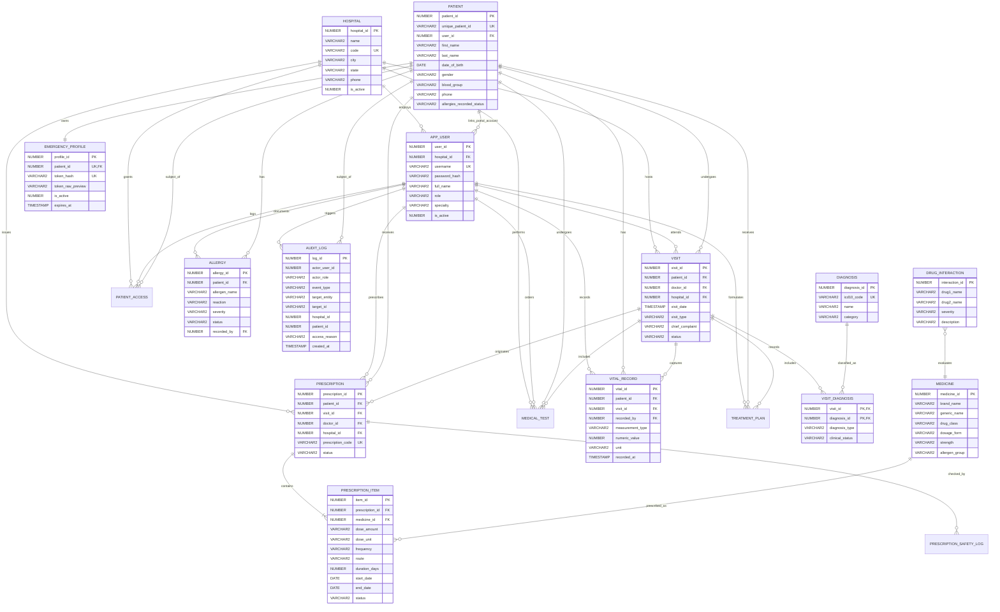

# MediVault Entity-Relationship (ER) Diagram

The MediVault database design follows third normal form (3NF), minimizing redundancy while preserving historical clinical traceability and referential integrity.

## Mermaid ER Diagram

## Relational Integrity & Normalization Rationale

1. **First Normal Form (1NF)**: All attributes are atomic. Prescription medications are itemized in `PRESCRIPTION_ITEM` rather than concatenated in a comma-delimited string. Diagnoses are decoupled into `VISIT_DIAGNOSIS`.
2. **Second Normal Form (2NF)**: All non-key attributes are fully functionally dependent on the entire primary key. In junction table `VISIT_DIAGNOSIS`, clinical status and diagnosis type pertain strictly to that specific visit-diagnosis pair.
3. **Third Normal Form (3NF)**: Transitive dependencies are removed. Hospital details reside in `HOSPITAL`, user details in `APP_USER`, medicine specifications in `MEDICINE`, preventing update and insertion anomalies.
4. **Historical Immutability**: Modifying or discontinuing a medication changes the status of `PRESCRIPTION` or `PRESCRIPTION_ITEM` and triggers an audit log, preserving complete longitudinal traceability for patient safety.
