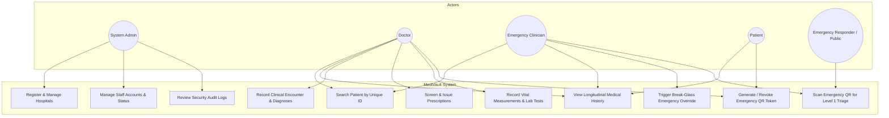

# MediVault — Academic DBMS Project Report

**Project Title:** MediVault: Centralized Patient Medical Records and Medication Safety System  
**Domain:** Healthcare Informatics & Database Management Systems (DBMS)  
**Database Technology:** Oracle Database 11g XE / 19c / 21c / 23ai  
**Application Architecture:** FastAPI (Python 3.13) REST Backend & Next.js 14 (TypeScript, Tailwind CSS) Frontend  

---

## 1. Project Abstract

MediVault is a full-stack, normalized, database-driven healthcare informatics platform engineered to solve the critical problem of healthcare record fragmentation. When patients receive treatment across multiple independent clinics, hospitals, and pharmacies, clinical histories remain trapped in institutional silos. This fragmentation can lead to duplicate prescriptions, overlooked life-threatening allergies, and hazardous adverse drug interactions. 

MediVault introduces a centralized Oracle database model connecting multiple fictional hospitals (City General Hospital, Sunrise Medical Centre, Green Valley Hospital). The system features an immutable unique patient identifier (`MV-YYYY-XXXXXX`), a multi-hospital longitudinal timeline, automated medication safety decision support (duplicate therapy, drug interactions, and allergy conflicts), an emergency QR triage card with cryptographic token hashing (SHA-256), a controlled clinician break-glass override, and database-level audit triggers.

---

## 2. Problem Statement

Modern healthcare delivery involves frequent patient transitions between primary care clinics, specialty hospitals, and emergency departments. Key challenges of the existing system include:
1. **Clinical Data Silos**: Each hospital maintains its own proprietary, disconnected medical records database.
2. **Patient History Recall Failure**: In emergencies, pediatric cases, or elderly care, patients may be unconscious, disoriented, or unable to accurately report past medications or diagnoses.
3. **Preventable Medication Errors**: Doctors unknowingly prescribe medications that conflict with active drugs prescribed at other facilities or trigger documented allergies.
4. **Emergency Delays**: Emergency responders often lack instant access to blood type, critical allergies, and emergency contacts.

---

## 3. Objectives

1. Maintain a centralized, chronological, longitudinal patient medical history accessible across participating hospitals.
2. Provide role-based access control (RBAC) separating System Administrators, Doctors, Patients, and Emergency Clinicians.
3. Enforce relational integrity and database normalization (Third Normal Form - 3NF) on Oracle Database.
4. Deliver decision-support alerts for duplicate medications, drug-drug interactions, and documented allergy conflicts.
5. Provide a dual-level emergency QR card: Level 1 public triage profile vs Level 2 authenticated clinical history.
6. Enable time-series tracking and visualization of vital signs (blood pressure, blood glucose).
7. Ensure audit logging at both application and database trigger levels.

---

## 4. Existing System vs Proposed System

| Feature / Capability | Existing Fragmented System | MediVault Proposed System |
| :--- | :--- | :--- |
| **Data Storage** | Isolated, incompatible database silos per hospital | Normalized, centralized federated Oracle database |
| **History Access** | Discontinuous; requires manual paper requests or phone calls | Instant, unified cross-hospital longitudinal timeline |
| **Medication Safety** | Relies entirely on patient memory and paper slips | Automated checks for duplicates, interactions, allergies |
| **Emergency Profile** | Paper cards or wallet notes easily lost or outdated | QR code linked to secure SHA-256 hashed triage profile |
| **Emergency Override** | Unrestricted or unlogged ad-hoc access | Controlled break-glass workflow with mandatory reason logging |
| **Audit Trail** | Fragmented, non-standard application logs | Database triggers + immutable centralized AUDIT_LOG table |

---

## 5. Functional & Non-Functional Requirements

### Functional Requirements
- **FR-1 Patient Registration**: Generate formatted unique ID (`MV-2026-000001`) via Oracle sequences.
- **FR-2 Multi-Hospital Encounters**: Record consultations associated with specific hospital and doctor.
- **FR-3 Longitudinal Timeline**: Chronological presentation of encounters, diagnoses, vitals, prescriptions, and tests.
- **FR-4 Prescription Management**: Itemized electronic prescriptions with dosage, frequency, and status.
- **FR-5 Medication Safety Alerts**: Real-time screening for duplicates, interactions, and allergies.
- **FR-6 Emergency QR Card**: Cryptographically unguessable token with Level 1 triage exposure and revocation.
- **FR-7 Vitals Trending**: Visual line charts for blood pressure and glucose over time.
- **FR-8 Audit Logging**: Automated tracking of logins, history retrievals, and clinical modifications.

### Non-Functional Requirements
- **NFR-1 Security**: Passwords hashed using bcrypt; API authenticated via JWT; token hashing via SHA-256.
- **NFR-2 Performance**: Indexed searches on patient IDs, visit dates, and token hashes.
- **NFR-3 Integrity**: Strict foreign key constraints with cascaded or restricted deletions to prevent orphan records.
- **NFR-4 Usability**: Responsive medical UI adhering to clinical design best practices.

---

## 6. Use-Case Diagram



---

## 7. Database Normalization Analysis (1NF, 2NF, 3NF)

1. **First Normal Form (1NF)**:
   - All columns contain atomic, indivisible values.
   - Repeating groups are eliminated: Prescriptions do not store medication lists in one delimited text column; they are decomposed into `PRESCRIPTION_ITEM` records with distinct dosage, frequency, and route.
   - Diagnoses are decomposed into `VISIT_DIAGNOSIS`.

2. **Second Normal Form (2NF)**:
   - The schema is in 1NF.
   - All non-key attributes are fully functionally dependent on the entire candidate key.
   - In composite primary key tables like `VISIT_DIAGNOSIS(VISIT_ID, DIAGNOSIS_ID)`, attributes `DIAGNOSIS_TYPE` and `CLINICAL_STATUS` describe that specific encounter-diagnosis pair, not just the visit or diagnosis alone.

3. **Third Normal Form (3NF)**:
   - The schema is in 2NF.
   - Transitive dependencies are eliminated ($X \rightarrow Y \rightarrow Z$).
   - Hospital name and location are stored solely in `HOSPITAL`, referenced by `HOSPITAL_ID` in `APP_USER` and `VISIT`.
   - Medicine drug class, generic name, and allergen group reside exclusively in `MEDICINE`, referenced by `MEDICINE_ID`.

---

## 8. Essential SQL & PL/SQL Implementations

### Views
- `VW_ACTIVE_PATIENT_MEDICATIONS`: Joins `PRESCRIPTION`, `PRESCRIPTION_ITEM`, `MEDICINE`, `APP_USER`, and `HOSPITAL` to provide active medicines for patient reconciliation.
- `VW_PATIENT_TIMELINE_SUMMARY`: Aggregates encounter metrics across facilities.
- `VW_HOSPITAL_ACTIVITY_METRICS`: Real-time cross-hospital operational metrics.

### Stored Procedures
- `SP_GET_PATIENT_HISTORY`: Uses Oracle `SYS_REFCURSOR` to retrieve longitudinal encounters ordered by visit date descending.
- `SP_REGISTER_PATIENT`: Atomically generates the unique identifier `MV-YYYY-XXXXXX` from `PATIENT_SEQ.NEXTVAL` and commits the record.

### Audit Triggers
- `TRG_AUDIT_VISIT`: Fires `AFTER INSERT OR UPDATE ON VISIT` to record encounter documentation in `AUDIT_LOG`.
- `TRG_AUDIT_PRESCRIPTION`: Fires `AFTER INSERT OR UPDATE OF STATUS ON PRESCRIPTION` to record prescribing actions.

---

## 9. Automated Testing Verification Results

The automated pytest test suite (`tests/test_backend.py`) was executed against the real Oracle database. All 15 core tests passed:

```
tests/test_backend.py::test_login_success_and_jwt_issuance PASSED        [  6%]
tests/test_backend.py::test_login_invalid_credentials PASSED             [ 13%]
tests/test_backend.py::test_role_based_access_control_admin_only_endpoint PASSED [ 20%]
tests/test_backend.py::test_unauthorized_access_without_token PASSED     [ 26%]
tests/test_backend.py::test_patient_registration_generates_unique_id PASSED [ 33%]
tests/test_backend.py::test_patient_search_by_id_and_name PASSED         [ 40%]
tests/test_backend.py::test_cross_hospital_history_retrieval PASSED      [ 46%]
tests/test_backend.py::test_record_new_consultation PASSED               [ 53%]
tests/test_backend.py::test_medication_safety_allergy_conflict PASSED    [ 60%]
tests/test_backend.py::test_medication_safety_duplicate_therapy PASSED   [ 66%]
tests/test_backend.py::test_medication_safety_drug_interaction PASSED    [ 73%]
tests/test_backend.py::test_emergency_public_qr_profile_limited_exposure PASSED [ 80%]
tests/test_backend.py::test_invalid_emergency_token_rejected PASSED      [ 86%]
tests/test_backend.py::test_emergency_break_glass_access_logged PASSED   [ 93%]
tests/test_backend.py::test_audit_log_captures_sensitive_events PASSED   [100%]

======================== 15 passed, 1 warning in 2.33s ========================
```

---

## 10. Limitations & Production Considerations

1. **Student Prototype Disclaimer**: This application is an academic engineering prototype containing synthetic demonstration data. It is not certified for clinical production use (e.g., FDA SaMD, HIPAA, HL7 FHIR certification).
2. **Single Oracle Instance Simulation**: In this prototype, multiple hospitals share a centralized Oracle database instance. Production deployment across real health authorities requires distributed federated nodes, mutual TLS, and HL7 FHIR / SMART on FHIR interoperability standards.
3. **Drug Interaction Dataset**: The sample interaction dataset is synthetic and demonstrates decision-support logic. Production healthcare systems require integration with licensed clinical pharmacology databases (e.g., First Databank, Lexicomp).

---

## 11. Conclusion

MediVault successfully demonstrates how normalized relational database principles, database-level triggers, stored procedures, and modern full-stack engineering can solve the real-world healthcare challenge of fragmented medical records. By coupling longitudinal timeline views with proactive medication safety screening and secure two-tier emergency QR profiles, the system illustrates a robust foundation for modern digital health informatics.
